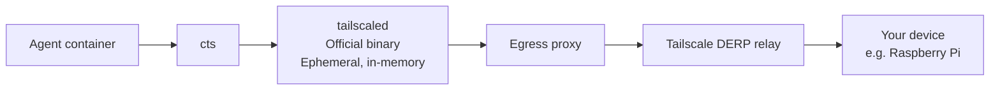

# Cloud-Tailscale

Connect Claude Code on the web to your own Tailscale tailnet and reach private devices by name.

[](https://www.npmjs.com/package/cloud-tailscale)
[](https://github.com/Dasannn/Cloud-Tailscale/actions/workflows/ci.yml?query=branch%3Amain)
[](LICENSE)
[](package.json)

Run commands on a home Raspberry Pi from Claude Code on the web, the
supported target, without root, OpenSSH, or `sshpass` in the container. The
npm package is `cloud-tailscale`; its command is `cloud-tailscale`, with the
short alias `cts`.

## Why

Cloud agent containers sit behind an egress proxy, cannot accept inbound
connections, and often lack root or a TUN device. They are ephemeral, so
each session starts fresh. Cloud-Tailscale handles joining your tailnet
and reaching your devices in that environment.

## How it works

Cloud-Tailscale installs the official Tailscale client, joins as an ephemeral
node with in-memory state, and provides SSH and TCP access through the cloud
environment's egress proxy.



Direct UDP is usually blocked by the cloud environment, so traffic is
relayed through Tailscale DERP, with additional latency.

## 30-second example

With `cts` installed and your [access configured](#configure-access-once),
ask the agent to run a command on your device:

```bash
cts up
cts ssh pi@raspberry -- uname -a
cts down
```

Use your device's MagicDNS name or Tailscale IP and an authorized SSH user.

## Requirements

- Linux x86_64 or arm64, Node.js 20 or later, npm, `tar`, and `gzip`.
- Your own Tailscale tailnet and an auth key configured as described below.
- Outbound HTTPS to the npm registry and Tailscale hosts, with POST allowed
  for the control plane. Preserve the provider's proxy and CA settings.
- For SSH, a running SSH server on the target device and an authorized SSH
  account. Root and a TUN device in the cloud container are optional.

## Configure access once

In the Tailscale admin console, create a **Reusable**, **Ephemeral**,
**Pre-approved** auth key with a dedicated tag such as `tag:cloud-agent`.
Configure tag ownership and restrict the tag to the devices and ports the
agent needs before creating the key.

For example, this minimal tailnet policy permits the cloud agent to reach
only TCP port 22 on one device:

```json
{
  "tagOwners": {
    "tag:cloud-agent": ["autogroup:admin"]
  },
  "hosts": {
    "raspberry5": "100.64.0.10"
  },
  "acls": [
    {
      "action": "accept",
      "src": ["tag:cloud-agent"],
      "proto": "tcp",
      "dst": ["raspberry5:22"]
    }
  ]
}
```

Replace `100.64.0.10` with your device's Tailscale IP. Review the whole
policy: rules are additive, so existing broad ACLs or grants, including an
allow-all rule, must be narrowed or removed for this restriction to hold.
The policy alias does not rename the device; use its actual MagicDNS name
or IP in commands. See the [Tailscale policy reference](https://tailscale.com/docs/reference/syntax/policy-file).

Add credentials through your cloud environment's **secrets** configuration:

| Variable | Purpose |
| --- | --- |
| `TS_AUTHKEY` | Tailscale auth key; `TAILSCALE_AUTHKEY` is a fallback. |
| `TS_SSH_USER` | Optional default SSH user. |
| `TS_SSH_KEY` | SSH private key content; recommended over passwords. |
| `TS_SSH_KEY_FILE` | Alternative path to a private key outside the project. |
| `TS_SSH_PASSWORD` | SSH password if no private key is configured. |

Authorize a dedicated SSH public key on the target device. SSH credentials
and tailnet access are separate; Cloud-Tailscale does not configure the
remote SSH server. Never paste secrets into chat, command arguments, setup
scripts, or repository files.

## Quick start: Claude Code on the web

After the package is released, add this line to the environment's setup
script:

```bash
npm install -g cloud-tailscale && cts setup || true
```

The global install puts `cts` on PATH for the session. Setup connects and
installs the Claude Code skill. `|| true` lets the session start if setup
fails; review its report and have the agent check the connection:

```bash
cts status
cts ssh dasan@raspberry5 -- uname -a
cts down
```

Alternatively, use `npx -y cloud-tailscale setup`. For subsequent commands,
use `npx -y cloud-tailscale` wherever these examples say `cts` if it is not
on PATH. If the daemon did not survive setup, run `cts up` again.
See the [Claude Code guide](docs/guides/claude-code.md)
for secrets and network configuration.

## Codex Cloud

Codex Cloud is not supported yet: its egress proxy blocks Tailscale's
control protocol upgrade, and the configured built-in VPN did not provide
a working TCP path in live testing. See
[decision 0002](docs/decisions/0002-codex-cloud.md) for the evidence and
conditions for revisiting support.

## Commands

| Command | Behavior |
| --- | --- |
| `cts setup` | Connect and install the user skill on Claude Code. Missing auth keys defer connection without failing setup. |
| `cts up` | Install Tailscale if needed and connect; safe to repeat. Options: `--hostname <name>`, `--mode auto\|kernel\|userspace`, `--accept-routes`, `--tailscale-version <version>`. |
| `cts status` | Report installation, connection, node IP, mode, and peers. |
| `cts down` | Log out and stop the daemon; safe when already stopped. |
| `cts ssh [user@]host -- command...` | Run a command and return its exit code. Omit `-- command...` for a terminal shell. |
| `cts nc host port` | Open a raw TCP stream, also usable as an OpenSSH `ProxyCommand`. |
| `cts env` | Print proxy exports for tools accessing tailnet destinations. Scope them to those requests; keep the provider's HTTPS proxy intact. |
| `cts ssh-config` | Add managed OpenSSH entries for online peers when OpenSSH is available. |
| `cts skill --print` | Print the packaged agent skill. |
| `cts skill --install` | Install the Claude Code user skill. |
| `cts skill --repo` | Explicitly write the repository skill for review and commit. |
| `cts --version` / `cts --help` | Print the package version or help. |

Commands print plain text by default; add `--json` for an `ok`, `message`,
and `data` result. Errors include a stable code and next step, and exit
nonzero. `ssh` returns the remote command's exit code; `nc` streams TCP.
Flags after SSH's `--` go to the remote command. Connection commands
(`ssh`, `ssh-config`, `nc`, `env`) reconnect automatically when needed if an
auth key is available.

Set `CLOUD_TAILSCALE_HOME` to choose a private runtime directory outside the
project; otherwise a writable `~/.cloud-tailscale` or
`$TMPDIR/cloud-tailscale` is used. Set `CLOUD_TAILSCALE_VERSION` to pin the
Tailscale version; `up --tailscale-version` overrides it.

## Security and limits

- Official Tailscale downloads are verified with published SHA-256 checksums.
  Tailscale itself is downloaded at runtime and is not bundled in npm.
- Auth keys reach Tailscale through a private temporary file removed after
  joining. Output and daemon logs mask credentials. Runtime directories are
  private; Tailscale state stays in memory. Use an ephemeral auth key and
  `cts down` to remove the node immediately when finished.
- SSH trusts a host key on first use and rejects changes. Verify a changed
  key with the device owner before updating trust. Prefer SSH keys to passwords.
- Proxy listeners bind to loopback only. No hosted service receives your
  credentials; traffic travels through Tailscale. Files stay outside the
  project except when you explicitly add the repository skill.
- Cloud egress proxies commonly block direct UDP, so connections use DERP
  relays and have additional latency. Userspace mode requires `cts ssh`,
  `cts nc`, or a proxy-aware tool; ordinary container DNS does not resolve
  tailnet names automatically.
- No exit-node routing, inbound services, persistent node state, macOS, or
  Windows support. Each new cloud session needs installation and connection.
  Codex Cloud is unsupported in v0.1.x; see
  [decision 0002](docs/decisions/0002-codex-cloud.md).

See [troubleshooting](docs/guides/troubleshooting.md),
the [release guide](docs/guides/release.md),
and the [changelog](CHANGELOG.md). To report a vulnerability privately, see
the [security policy](SECURITY.md).

**Related:** [Agent-Bridge](https://github.com/Dasannn/Agent-Bridge).

## License

Licensed under [MIT](LICENSE).
